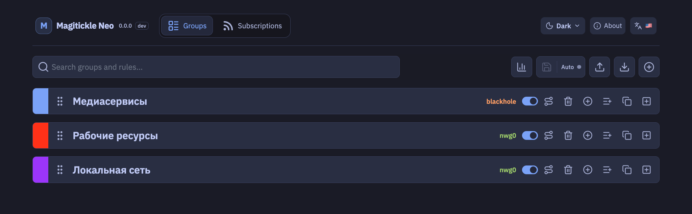

<p align="center">
  
</p>

<h1 align="center">MagiTrickle Neo</h1>

<p align="center">Выбор маршрута для доменов и подсетей на маршрутизаторах Keenetic с Entware.</p>

## Возможности

- **Маршрутизация по правилам:** домены, домены с поддоменами, wildcard-шаблоны, регулярные выражения, подсети IPv4 и IPv6.
- **Группы:** собственные правила, выбранный интерфейс, включение/выключение, импорт и экспорт конфигурации.
- **Failover:** основной и резервные интерфейсы с настраиваемым приоритетом, необязательной TCP-проверкой доступности, интервалом и тайм-аутом проверок.
- **Blackhole:** выбор в качестве единственного маршрута группы блокирует её трафик.
- **Подписки:** загрузка списков правил по URL, периодическое обновление и ручная синхронизация.
- **WebUI:** управление группами и подписками, индикация текущего маршрута и активного резерва, статистика по кнопке, массовые действия, автосохранение и необязательная авторизация.

## Как это работает

MagiTrickle обрабатывает DNS-запросы клиентов и ответы DNS-сервера, сопоставляет домены с правилами и добавляет соответствующие IP-адреса в наборы `ipset`. Маршрутизация этих адресов выполняется через назначенные группе интерфейсы при помощи `iptables` и политик маршрутизации Linux. Правила подсетей применяются непосредственно, без ожидания DNS-запросов.

Для группы можно задать упорядоченный список резервных интерфейсов. При отказе основного выбирается первый доступный резерв; после восстановления основного маршрут может вернуться на него. Если включена TCP-проверка, доступность определяется по соединению с указанным адресом через проверяемый интерфейс. Без TCP-адреса проверяется состояние самого интерфейса.

`blackhole` можно выбрать как самостоятельный маршрут группы, чтобы блокировать её трафик. Защита от утечки в таблицах маршрутизации также не позволяет направить предназначенный группе трафик через произвольный маршрут при исчезновении рабочего маршрута.

DNS-кэш и уже установленные клиентские соединения могут влиять на момент применения новых доменных правил: адрес попадёт в маршрут после получения и обработки соответствующего DNS-ответа.

## Установка на Keenetic (Entware)

Для установки требуется Entware.

1. Скачайте `.ipk` для своей архитектуры со страницы [GitHub Releases](https://github.com/dm4web/magitrickle/releases). Архитектуру Entware можно проверить командой `opkg print-architecture`.
2. Скопируйте пакет на маршрутизатор как `/opt/tmp/magitrickle.ipk` и установите его:

```sh
opkg update
opkg install /opt/tmp/magitrickle.ipk
```

Для ручного запуска или перезапуска сервиса используйте:

```sh
/opt/etc/init.d/S99magitrickle start
/opt/etc/init.d/S99magitrickle restart
```

После запуска WebUI по умолчанию доступен по адресу `http://<IP-маршрутизатора>:8080`. Основной конфигурационный файл: `/opt/var/lib/magitrickle/config.yaml`. В стандартной конфигурации авторизация WebUI **выключена**: включите её перед доступом из недоверенных сетей и не открывайте порт напрямую в интернет.

## Типы правил

### Namespace — домен и поддомены

`example.com` совпадает с `example.com`, `sub.example.com`, `sub.sub.example.com`, но не с `anotherexample.com` и `example.net`.

### Wildcard — шаблон

`*` соответствует любой последовательности символов (включая пустую), `?` — одному символу. Например, `*example.com` совпадает с `example.com`, `sub.example.com` и `anotherexample.com`, но не с `example.net`.

### Domain — точный домен

`sub.example.com` совпадает только с `sub.example.com`, но не с `example.com` или `other.sub.example.com`.

### RegExp — регулярное выражение

Используется движок [dlclark/regexp2](https://github.com/dlclark/regexp2). Например, `^[a-z]*example\\.com$` совпадает с `example.com` и `anotherexample.com`, но не с `sub.example.com`.

### Subnet / Subnet6 — подсеть IPv4 / IPv6

`192.168.1.0/24` и `2001:db8::/32` направляют соответствующие диапазоны адресов без необходимости определять доменные имена через DNS.

## Разработка и проверка

WebUI расположен в `src/frontend` (Svelte + TypeScript), backend — в `src/backend` (Go). Для локальных проверок:

```sh
cd src/frontend
npm ci
npm run check
npm run test:unit
npm run build
npm run test:e2e
```

Linux-тесты failover, сборка IPK и тесты backend выполняются в [CI](https://github.com/dm4web/magitrickle/actions/workflows/check.yml). Подробности об эмуляторе Keenetic и интеграционных проверках — в [e2e/README.md](e2e/README.md). Проверки интерфейса локально используют mock API и не переключают реальные сетевые маршруты.

## Проект и ссылки

- [Этот репозиторий (GitHub)](https://github.com/dm4web/magitrickle)
- [Исходный проект (GitLab)](https://gitlab.com/magitrickle/magitrickle)
- [Сайт MagiTrickle](https://magitrickle.dev)
- [Тема на Keenetic Community](https://forum.keenetic.ru/topic/20125-magitrickle)
- [Telegram-канал](https://t.me/MagiTrickle) · [Telegram-чат](https://t.me/MagiTrickleChat)
- [Поддержка исходного проекта](https://boosty.to/magitrickle)
